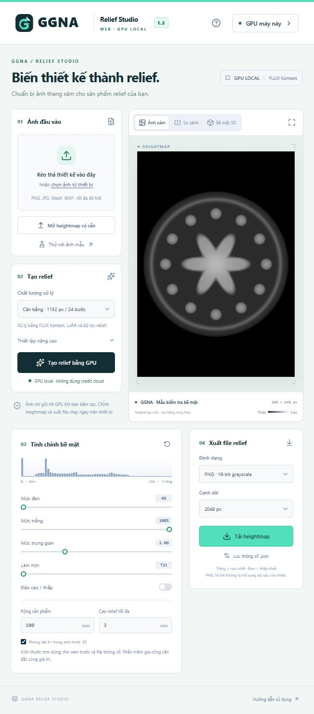

<p align="center"></p>

# GGNA Relief Studio

**Tạo và chỉnh ảnh relief thang độ xám ngay trên máy Windows của bạn.**

GGNA Relief Studio cung cấp giao diện web local để chuyển ảnh thiết kế thành heightmap bằng ComfyUI và GPU NVIDIA. Bạn có thể chỉnh vùng cao/thấp, xem trước bề mặt 3D và xuất PNG grayscale 16-bit hoặc BMP 8-bit để tiếp tục xử lý trong phần mềm gia công.

> **Trắng = cao nhất · Đen = thấp nhất.** Giao diện chạy trong trình duyệt sẵn có; tác vụ AI dùng GPU trên máy của người sử dụng. GitHub và Google Drive chỉ cung cấp mã nguồn, hướng dẫn và tệp tải.

## Tải bộ đầy đủ cho Windows

### [⬇ Tải GGNA Relief Studio 1.2.0 từ Google Drive](https://drive.google.com/drive/folders/11d_BVKexi-h1CQsFbjwsF-0F1C-yuc9s)

Trong thư mục Drive, tải **GGNA-Relief-Web-Full-1.2.0-Windows-x64.zip** và tệp **.sha256** đi kèm. Đọc **NOTICE.txt** trước khi sử dụng hoặc phân phối model.

| Gói | Dung lượng | Dành cho |
| --- | ---: | --- |
| Bộ Windows đầy đủ | 17,84 GB tải về; khoảng 22,49 GB giải nén | Người dùng chưa có Python, ComfyUI hoặc model |
| Mã nguồn repository này | Dưới 1 MB, không tính thư viện phát triển | Người phát triển hoặc muốn xem mã ứng dụng |

**Khách dùng bộ đầy đủ không cần cài Node.js, npm, Electron hay Python riêng.** Bộ đã kèm Python portable, ComfyUI, bốn bộ custom node và sáu tệp model. Vẫn cần GPU NVIDIA và driver tương thích.

SHA256 của bộ đầy đủ:

```text
4408fec17e7327f2683a789220fb474bafc315d34bcc09902756a29172796e75
```

## Ứng dụng làm được gì?

- Chuyển ảnh màu thành relief bằng workflow FLUX Kontext + LoRA trên GPU local.
- Đọc heightmap có sẵn, bao gồm PNG grayscale 16-bit.
- Chỉnh mức đen, mức trắng, gamma, làm mịn và đảo cao/thấp.
- Xem ảnh xám, so sánh ảnh và xoay preview bề mặt 3D.
- Xuất PNG grayscale 16-bit/8-bit hoặc BMP 8-bit; lưu thông số JSON.
- Chạy trong trình duyệt mặc định; không kèm Chromium riêng.

Ứng dụng xuất heightmap, **chưa xuất STL hoặc G-code**. Preview 3D dùng để kiểm tra bề mặt; độ sáng của preview không được ghi vào file heightmap.



## Yêu cầu máy

| Thành phần | Yêu cầu / phạm vi đã kiểm tra |
| --- | --- |
| Hệ điều hành | Windows x64 |
| GPU | NVIDIA hỗ trợ CUDA; đã thử trên RTX 3060 12 GB |
| Driver | Tương thích PyTorch 2.12.0 + CUDA 13.0 trong bộ đi kèm |
| RAM | Khuyến nghị 32 GB; ảnh/preset lớn có thể cần nhiều hơn |
| Lưu trữ | SSD local, khuyến nghị ít nhất 60 GB trống để giữ ZIP và bản giải nén |
| Trình duyệt | Chrome hoặc Edge hiện đại; cần WebGL để xem 3D |

Chưa xác minh mọi dòng GPU hoặc máy Windows sạch. Bộ này không phải bản chạy AI trên điện thoại, macOS, AMD hoặc CPU-only. Máy không có GPU phù hợp vẫn có thể không khởi động được phần tạo relief AI.

## Cài đặt và mở lần đầu

1. Mở [thư mục tải trên Drive](https://drive.google.com/drive/folders/11d_BVKexi-h1CQsFbjwsF-0F1C-yuc9s), tải ZIP đầy đủ và SHA256. Giữ nguyên tên tệp để dễ đối chiếu.
2. Có thể kiểm tra file trong PowerShell:

   ```powershell
   Get-FileHash -Algorithm SHA256 -LiteralPath '.\GGNA-Relief-Web-Full-1.2.0-Windows-x64.zip'
   ```

   Kết quả phải khớp chuỗi SHA256 phía trên hoặc tệp .sha256 đi kèm. Nếu không khớp, tải lại trước khi giải nén.
3. Giải nén **toàn bộ ZIP** vào thư mục có quyền ghi, ví dụ `D:\GGNA-Web`. Không chạy BAT trực tiếp từ cửa sổ xem ZIP. Không dùng ổ FAT32 cho tệp ZIP lớn hơn 4 GB.
4. Nên dùng đường dẫn ngắn trên SSD. Tránh Program Files, thư mục chỉ đọc, ổ mạng và thư mục đồng bộ cloud khi vận hành.
5. Chạy **KHOI-DONG.bat** ở gốc bộ giải nén. Trình duyệt mặc định sẽ mở giao diện; chờ nhãn **GPU máy này**.
6. Lần khởi động đầu có thể mất vài phút. Model AI được nạp khi tạo ảnh; không bấm tạo nhiều lần trong lúc chờ.

Địa chỉ mặc định: `http://127.0.0.1:4180/`. ComfyUI đi kèm dùng `127.0.0.1:8190`. Nếu cổng web bị chiếm, launcher chọn cổng trống và mở đúng địa chỉ. Cổng GPU đang thuộc bộ khác cần được xử lý theo hướng dẫn lỗi bên dưới.

## Tạo relief: từng bước

### 1. Chọn ảnh đầu vào

Kéo ảnh vào ô tải hoặc bấm chọn ảnh. Các định dạng được nhận: PNG, JPG, WebP, BMP; giới hạn tải giao diện là 40 MB. Ảnh sẽ được chuẩn bị lại thành PNG theo preset trước khi gửi tới ComfyUI local.

Nếu đã có heightmap, dùng **Mở heightmap có sẵn** để chỉnh và xuất ngay. Mẫu hình học mặc định được tạo bằng công thức để thử giao diện, không phải đầu ra của model và không dùng để đánh giá chất lượng AI.

### 2. Chọn chất lượng và tạo

| Preset | Cạnh dài ảnh gửi GPU | Bước lấy mẫu |
| --- | ---: | ---: |
| Thử nhanh | Tối đa 768 px | 20 |
| Cân bằng | Tối đa 1152 px | 24 |
| Gần nguyên bản | Tối đa 2048 px | 24 |

Bắt đầu bằng **Thử nhanh** với một ảnh nhỏ. Khi GPU sẵn sàng, bấm **Tạo relief bằng GPU** và giữ máy bật. Seed có thể đặt trong thiết lập nâng cao để đối chiếu các lần thử với cùng cấu hình. Không đảm bảo đầu ra giống từng byte giữa các máy, phiên bản driver hoặc thư viện khác nhau.

Nếu mất kết nối khi tác vụ đang chạy, dùng **Kiểm tra tác vụ** khi nút này xuất hiện để tiếp tục theo dõi tác vụ cũ. Tránh gửi lại liên tục vì có thể tạo thêm công việc trên GPU.

### 3. Chỉnh mức xám và kiểm tra

- **Mức đen:** điều chỉnh vùng thấp nhất.
- **Mức trắng:** điều chỉnh vùng cao nhất.
- **Mức trung gian:** thay đổi gamma để phân bố độ cao.
- **Làm mịn:** giảm chuyển tiếp gắt; tăng vừa phải để giữ chi tiết.
- **Đảo cao/thấp:** đổi vùng nổi thành lõm và ngược lại.
- **Bề mặt 3D:** kéo để xoay, cuộn để phóng/thu. Phóng đại 3× chỉ ảnh hưởng preview.

Kiểm tra chữ, viền, mắt, lỗ nhỏ và các vùng cần cao/thấp thực tế. Ảnh đẹp về thị giác chưa đủ để đảm bảo heightmap phù hợp với vật liệu, máy hoặc phương pháp gia công của bạn.

### 4. Xuất file

Chọn PNG 16-bit grayscale, PNG 8-bit hoặc BMP 8-bit; chọn cạnh dài 1024/2048/4096 px hoặc giữ kích thước đang chỉnh, rồi bấm **Tải heightmap**. Lưu JSON nếu cần lưu lại thông số.

PNG 16-bit giúp giữ mức xám của dữ liệu hiện có; chuyển nguồn 8-bit sang 16-bit hoặc tăng kích thước không tự tạo thêm chi tiết/độ sâu thật. Preview được rút gọn để hiển thị. Các giá trị rộng sản phẩm/cao relief (mm) dùng cho preview và JSON; cần đặt lại cùng giá trị trong phần mềm gia công, không mặc nhiên được áp vào máy sản xuất chỉ bằng việc xuất PNG.

## Dừng ứng dụng và quản lý dữ liệu

Chạy **DUNG_TOOL.bat** khi dùng xong. **Đóng tab không dừng GPU.** Dừng tool sẽ dừng tác vụ đang chạy của phiên do tool mở.

Ảnh đầu vào/kết quả, log, database và khóa tác vụ nằm trong thư mục **data** của bản đã giải nén. Không chia sẻ thư mục này khi gửi bộ cài cho người khác. Sao lưu ảnh cần giữ trước khi thay bộ cài hoặc dọn dữ liệu.

Ứng dụng chỉ lắng nghe trên loopback của máy hiện tại. Không đổi sang địa chỉ mạng công cộng hoặc mở cổng router nếu chưa xây dựng xác thực và bảo vệ dịch vụ phù hợp. Người truy cập repository này không sử dụng GPU của chủ repository.

## Lỗi thường gặp

| Hiện tượng | Cách kiểm tra |
| --- | --- |
| Thiếu Python/model/node | Giải nén toàn bộ ZIP; đối chiếu thông báo file thiếu. Không chạy trong ZIP. |
| Chưa nhận GPU CUDA | Kiểm tra máy có NVIDIA và driver tương thích; xem log ComfyUI. |
| Thiếu VRAM hoặc bị dừng | Dùng Thử nhanh, giảm kích thước ảnh, đóng ứng dụng GPU khác; kiểm tra RAM/VRAM. |
| Cổng GPU thuộc bộ ComfyUI khác | Dừng đúng phiên đang chiếm cổng nếu bạn không dùng nó, hoặc chạy launcher với cổng khác; không kết thúc tác vụ người khác đang chạy. |
| Trình duyệt chưa mở | Chờ khởi động, xem thông báo launcher và data/logs/web.log; mở lại bằng BAT. |
| Không xem được 3D | Dùng Chrome/Edge hỗ trợ WebGL; vẫn có thể chỉnh ảnh xám và xuất file. |
| Dừng ở lần mở đầu | Kiểm tra dung lượng SSD, quyền ghi, driver và data/logs/comfy-stderr.log. |
| SHA256 không khớp | Không sử dụng bản tải đó; tải lại và đối chiếu đúng phiên bản. |
| Drive không cho tải được | Kiểm tra quyền truy cập hoặc thử lại sau; Drive có thể áp dụng giới hạn tải của dịch vụ. |

Log chính: `data/logs/web.log`, `data/logs/comfy-stdout.log`, `data/logs/comfy-stderr.log`. Khi báo lỗi, không gửi khóa .key, ticket tác vụ hoặc ảnh riêng tư. Có thể tạo issue với cấu hình GPU/driver, preset và đoạn log lỗi đã loại bỏ dữ liệu riêng.

## Kiểm chứng bản 1.2.0

- Python 3.13.12, PyTorch 2.12.0+cu130, ComfyUI 0.26.0; RTX 3060 12 GB.
- Tác vụ thử nội bộ: input 512×512, draft 20 bước, seed 408416742087713; nhận PNG 2048×2048. ComfyUI ghi 49,31 giây cho tác vụ đó; đây không phải cam kết tốc độ cho mọi máy/ảnh.
- Xuất PNG grayscale một kênh 16-bit 2048×2048 từ giao diện thành công; mẫu thử có 41.246 mức xám.
- Sáu model khớp SHA256 trong manifest; ZIP đầy đủ đã kiểm tra CRC bằng 7-Zip.
- 6 kiểm tra backend Python, 19 kiểm tra xử lý ảnh/workflow/API, TypeScript và Vite build đã qua.

Xem [thông tin kiểm chứng](docs/VERIFICATION.md). Chưa thử trên mọi GPU hoặc máy Windows sạch.

## Phát triển từ mã nguồn

Repository này có mã UI và launcher/backend Python; **không chứa engine hoặc model**. Tải bộ đầy đủ nếu bạn chỉ muốn sử dụng ứng dụng.

Node.js 24 dùng cho phát triển UI:

```powershell
npm ci
npm run typecheck
npm test
npm run build
```

Backend dùng thư viện chuẩn Python. Kiểm tra bằng Python tương thích:

```powershell
python -B python/test_ggna.py
```

| Đường dẫn | Nội dung |
| --- | --- |
| app/ | Giao diện React và CSS |
| lib/ | Heightmap, preview 3D, helper workflow/API |
| python/ggna_server.py | Launcher, máy chủ local, kết nối ComfyUI |
| python/workflow_api.json | Graph API dùng khi chạy |
| public/ | Logo GGNA, mẫu hình học, hướng dẫn và ảnh giao diện |
| tests/, python/test_ggna.py | Các kiểm tra chức năng |
| scripts/assemble-bundle.ps1 | Ghép UI đã build với engine có sẵn vào thư mục mới |
| licenses/, NOTICE.txt | Giấy phép và thông báo bên thứ ba |

Sau khi build, có thể dùng helper với thư mục engine từ bộ đã tải:

```powershell
.\scripts\assemble-bundle.ps1 -EngineSource 'D:\GGNA-Web\engine' -Destination 'D:\GGNA-New-Bundle'
```

Chọn thư mục đích mới. Helper không tải model hoặc cấp quyền sử dụng model. Không đưa engine, model, data, node_modules hoặc .env vào Git. Khi tự build lại, dung lượng/hash của bộ mới có thể khác bản phát hành này.

## Giấy phép và nguồn model

GGNA là thương hiệu ứng dụng và đơn vị đóng gói; **không nhận là tác giả của ComfyUI, FLUX hoặc các model bên thứ ba**.

- ComfyUI giữ giấy phép GPL; mã nguồn và giấy phép engine được kèm trong bộ Windows đầy đủ.
- FLUX.1 Kontext [dev] và biến thể FP8 giữ giấy phép của Black Forest Labs. Giấy phép tiêu chuẩn áp dụng giới hạn phi thương mại/phi sản xuất; quyền sử dụng thương mại hoặc phân phối ngoài phạm vi đó phải được chủ sở hữu cấp phù hợp.
- LoRA và upscaler BANMA được chủ bộ cài cung cấp; quá trình đóng gói chưa xác minh độc lập quyền thương mại/phân phối của chúng. Tên kỹ thuật được giữ để workflow chạy đúng. Không mặc nhiên coi việc tải được tệp là có đủ quyền sử dụng hoặc phân phối cho mọi mục đích.
- Python, PyTorch, custom nodes và thư viện UI giữ giấy phép riêng. Không áp một giấy phép MIT/Apache chung cho toàn bộ engine và model.

Đọc [NOTICE.txt](NOTICE.txt), [THIRD-PARTY-NOTICES.md](THIRD-PARTY-NOTICES.md) và [giấy phép FLUX](licenses/FLUX-1-dev-LICENSE.md). Phần mã app GGNA chưa được gán giấy phép nguồn mở riêng. Việc công khai mã nguồn/bộ tải không tự cấp thêm quyền thương mại cho model.

## Câu hỏi nhanh

**Có cần Comfy Cloud hoặc credit không?** Không, workflow của bộ này chạy bằng GPU local. Quyền sử dụng model vẫn theo giấy phép riêng.

**Chỉ tải “Code → Download ZIP” trên GitHub có chạy ngay không?** Không. Đó là mã nguồn, không có Python/ComfyUI/model. Người dùng thông thường hãy tải bộ đầy đủ từ Drive.

**Tải xong có cần mạng để tạo ảnh không?** Bộ đã có model; workflow xử lý trên máy và không dùng API tạo ảnh cloud. Mạng cần cho việc tải bộ cài, driver hoặc thư viện khi phát triển từ nguồn.

**Có dùng ngay cho sản xuất thương mại không?** Cần quyền phù hợp cho các model/LoRA và phải kiểm tra heightmap theo quy trình sản xuất. Bộ đóng gói không thay thế giấy phép model hoặc bước duyệt file.

**Có thể chạy bằng điện thoại không?** Điện thoại có thể đọc hướng dẫn/tải tệp, nhưng bộ Windows local này cần máy Windows và GPU NVIDIA để tạo ảnh.
